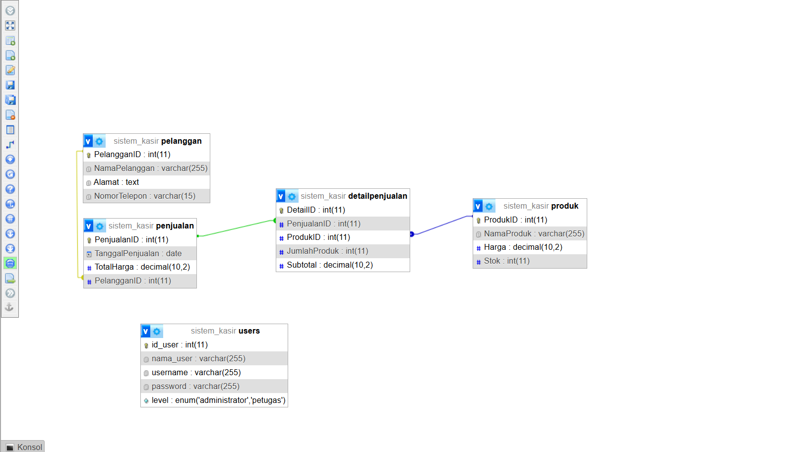
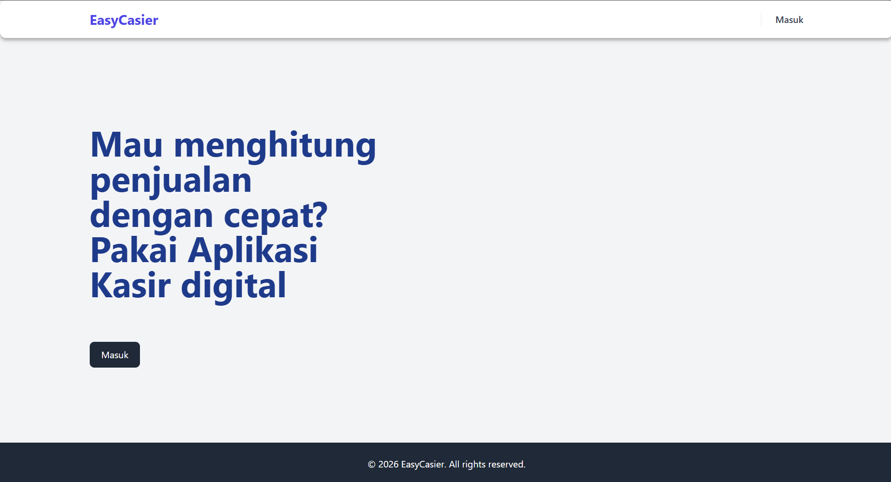
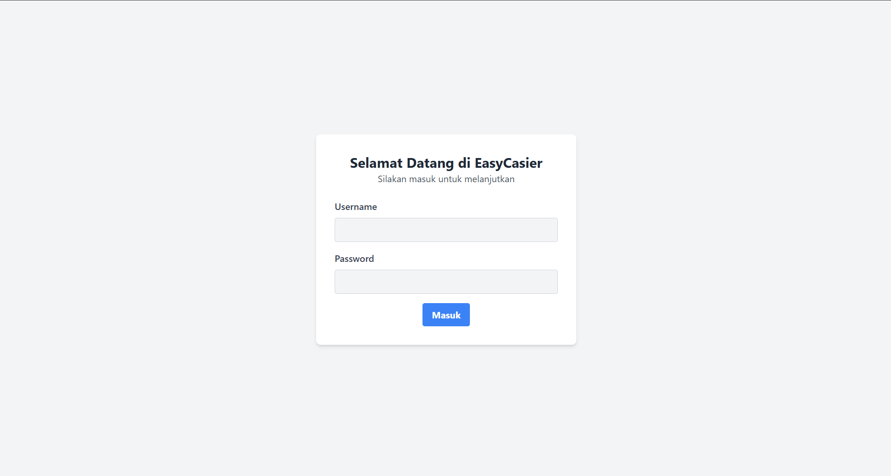
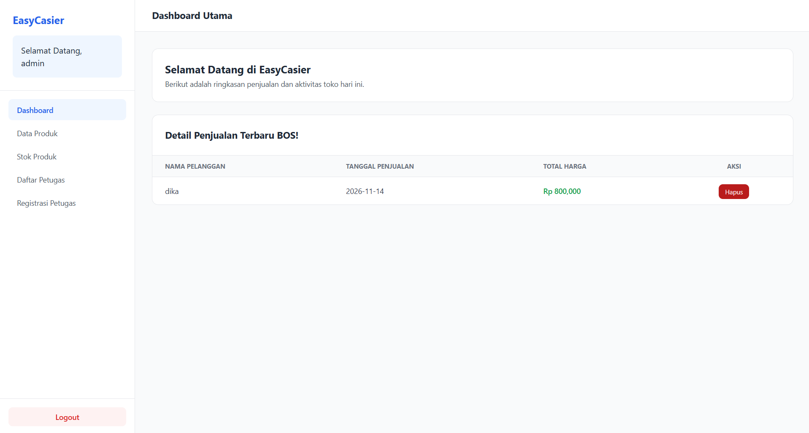
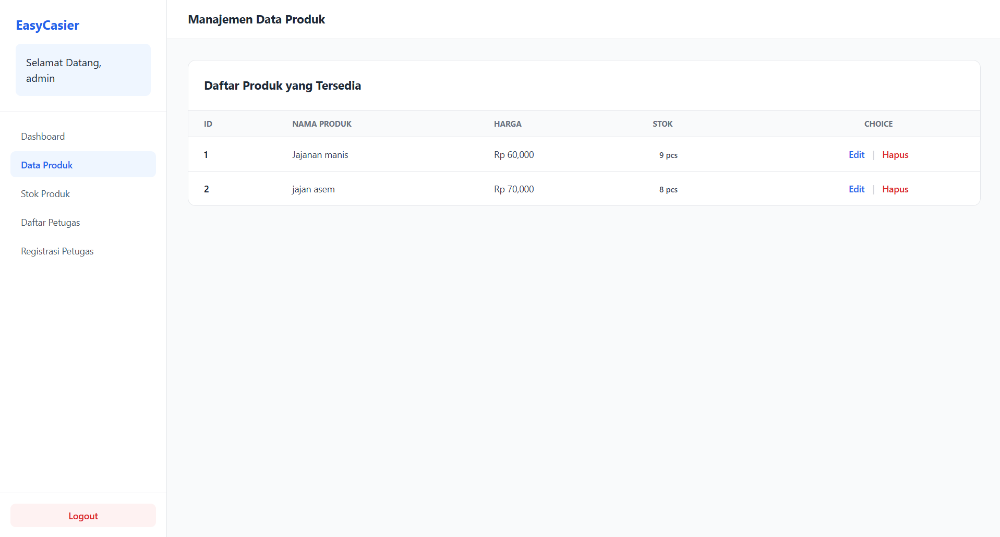
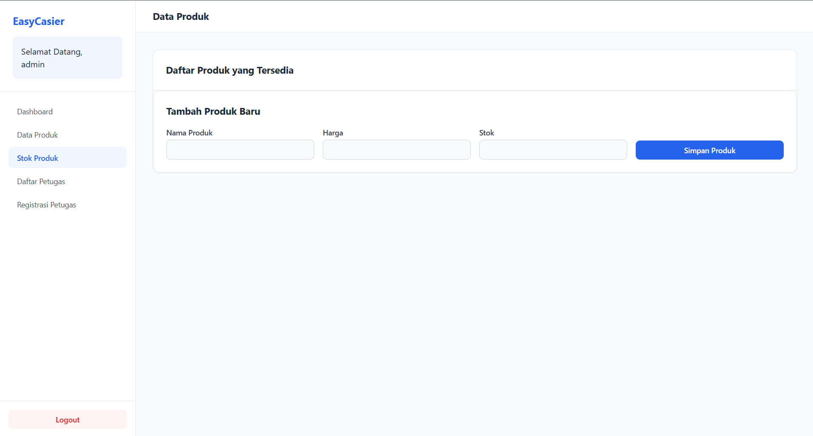
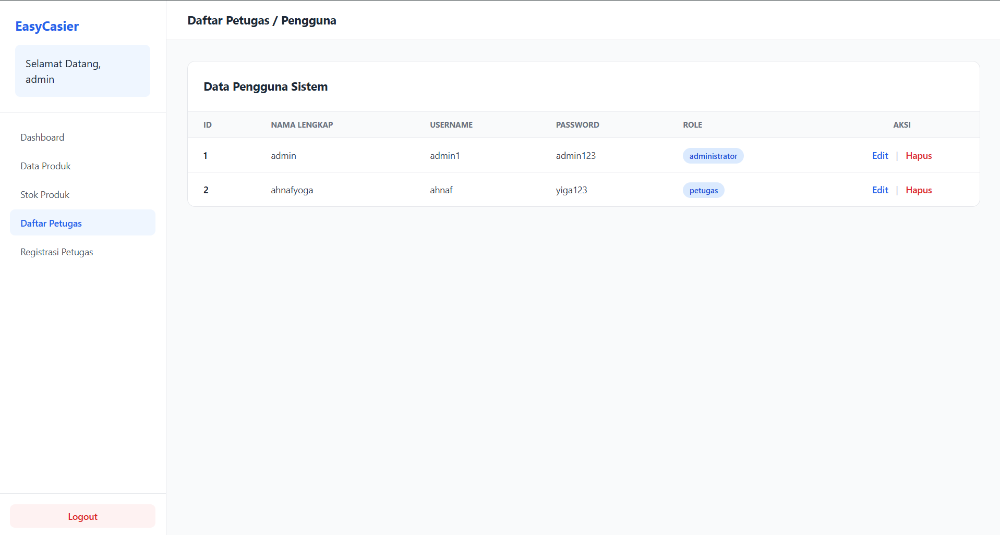
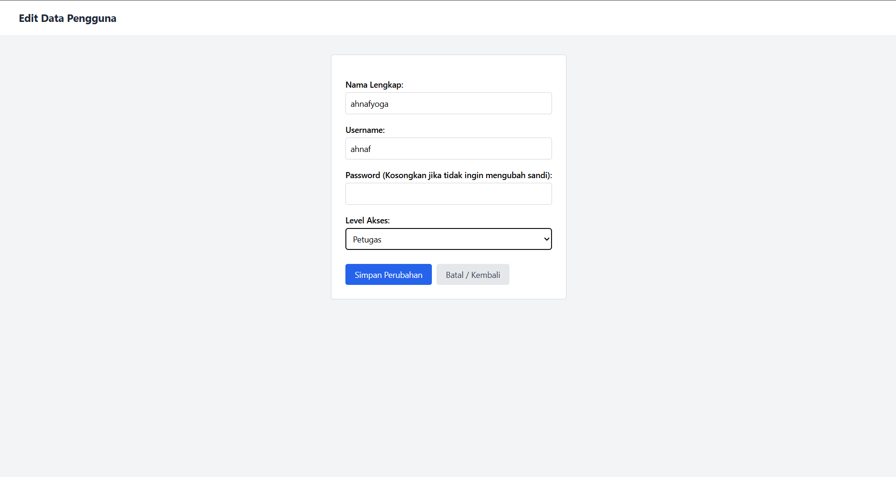

# Project UKK 
## Pembuatan web kasir berbasis digital
      
**Judul Tugas:** Membuat Aplikasi Kasir          
**Langkah Kerja:** 
1. Buatlah daftar kebutuhan teknis dan spesifikasi perangkat yang dibutuhkan pada
lembar yang disediakan !
2. Siapkan peralatan dan bahan yang diperlukan sesuai dengan daftar peralatan !
3. Installah text editor dan software pendukung lainnya yang digunakan untuk
memprogram aplikasi kasir !
4. Interpretasikan spesifikasi program yang diberikan
a. Aplikasi berbasis sistem client-server
b. Aplikasi dapat dibuat berbasis web atau perangkat bergerak
c. Aplikasi menggunakan pembagian privilege dengan tingkatan (administrator dan
petugas)
5. Buatlah Desain User Interface        

| Fitur | administrator | petugas |
|:---|:---:|---:|
| Login | X | X |
| Logout | X | X |
| Registrasi | X |  |
| Pendataan Barang | X | X |
| Pembelian |  |  |
| Stok Barang | X | X |

b. Desain dibuat dengan memperhatikan kaidah UI/UX              
c. Form pelaporan dibuat sekomunikatif mungkin      
d. Terapkan pemrograman berbasis objek (object oriented programming)                                            

6. Buatlah database yang digunakan untuk menambah, mengedit, menghapus, dan
melihat data penjualan barang !                                             
7. Running dan testing hasil program !                                      
8. Buatlah dikumentasi kode program dan upload portofolio pada github ! 


##  Fitur Login

*   **Fitur ADMIN:** Melihat isi dari stok produk, masuk kedalam dashboard admin, bisa akses pendataan barang, bisa edit ataupun menghapus dan menambah sebuah barang, dapat memantau detail penjualan, memiliki akses untuk melihat daftar pertugas, memiliki akses untuk menambah petuga.
*   **Fitur PETUGAS:** Dapat edit dan delete produk, dapat input data seorang pelanggan, memiliki akses untuk mennggunakan transaksi dan memiliki akses input barang yang di beli oleh pelanggan, melihat informasi produk

##  Tools yang Digunakan

*   [Native PHP (8.4.24)]
*   [TailwindCSS (3.4.17)]
*   [Database: MySQL]
*   [VSC (Visual Code Studio) : (1.146.0)]

##  Struktur Folder

```text
.
├── admin/                 
│   ├── admin_dashboard.php
│   ├── daftar_petugas.php
│   ├── edit_petugas.php
│   ├── edit_produk.php
│   ├── produk.php
│   ├── registrasi.php
│   └── stok_produk.php
├── backend/              
│   ├── detail_controller.php
│   ├── hapus_produk.php
│   ├── hapus_user.php
│   ├── koneksi.php
│   ├── login_controller.php
│   ├── logout.php
│   ├── pelanggan_controller.php
│   ├── penjualan_controller.php
│   ├── petugas_produk_edit.php
│   ├── produk_controller.php
│   ├── proses_edit_petugas.php
│   ├── proses_edit_produk.php
│   └── registrasi_controller.php
├── frontend/              
│   ├── detail.php
│   ├── edit_produk.php
│   ├── index.php
│   ├── login.php
│   ├── pelanggan.php
│   ├── penjualan.php
│   ├── produk.php
│   └── transaksi.php
├── image/                
screenshot aplikasi
│   ├── img1.jpg
│   ├── ss1.png
│   ├── ss2.png
│   ├── ss3.png
│   ├── ss4.png
│   ├── ss5.png
│   └── ss6.png
├── logic/
├── node_modules/          
Tailwind CSS
│   └── .bin/
├── .gitignore
├── image-1.png
├── image.png
├── package-lock.json
├── package.json
└── README.md
```
##  Desain ERD (Entity Relationship Diagram)



## Dokumentasi 

### Landing page


### Login page



### Logika dalam login.php
1. di sini user akan memasukkan user dan password, nah si username sama password akan di kirimkan ke login controller untuk di validasi ini itu bagian dari anggota atau admin.


```php
if ($users = mysqli_fetch_array($cek)) {
        switch ($users['level']) {
            case 'administrator':
                $_SESSION['id_user'] = $users['id_user'];
                $_SESSION['nama_user'] = $users['nama_user'];
                $_SESSION['level'] = $users['level'];
                $_SESSION['status_login'] = true;
                header("Location: /UkkKasirProject/admin/admin_dashboard.php");
                break;
            case 'petugas':
                $_SESSION['id_user'] = $users['id_user'];
                $_SESSION['nama_user'] = $users['nama_user'];
                $_SESSION['level'] = $users['level'];
                $_SESSION['status_login_admin'] = true;
                header("Location: /UkkKasirProject/petugas/petugas_dashboard.php");
                break;

```
* jika yang di masukkan user cocok dengan level/role petugas, user akan di arahkan ke petugas_dashboard.php dan begitu juga admin 

## Admin Dashboard
### Awal dashboard



1. Ini kondisi setelah masuk ke dashboard admin, di sini admin akan di perlihatkan penjualan, dari nama, tanggal dan total penjualan dan hapus. Logika nya seperti ini

```php
require 'koneksi.php';
if (!isset($_SESSION['id_user'])) { header("Location: index.php"); }

if (isset($_POST['buat_transaksi'])) {
    $tanggal = $_POST['TanggalPenjualan'];
    $pelanggan_id = $_POST['PelangganID'];
    
    $conn->query("INSERT INTO penjualan (TanggalPenjualan, TotalHarga, PelangganID) VALUES ('$tanggal', 0, '$pelanggan_id')");
    header("Location: penjualan.php");
}
```

ini membuat data dari input penjualan bisa di baca oleh admin dari admin_dashboard.php dan admin dapat menghapusnya dengan logic

```php
if (isset($_GET['PenjualanID'])) {
    $PenjualanID = $_GET['PenjualanID'];

    mysqli_query($conn, "DELETE FROM detailpenjualan WHERE PenjualanID = '$PenjualanID'");
    $query = "DELETE FROM penjualan WHERE PenjualanID = '$PenjualanID'";
    $hapus = mysqli_query($conn, $query);

    if ($hapus) {
        echo "<script>alert('Data penjualan berhasil dihapus!'); window.location.href='../admin/admin_dashboard.php';</script>";
    } else {
        echo "<script>alert('Gagal menghapus data penjualan!'); window.location.href='../admin/admin_dashboard.php';</script>";
    }
```

### Data Produk



### Edit data


1. Di sini ada page yang menampilkan data produk yang tersedia dan admin bisa delete dan edit data produk nya, logika dalam program nya seperti 

```php
include __DIR__ . '/koneksi.php';

$ProdukID = $_POST['ProdukID'];
$NamaProduk = $_POST['NamaProduk'];
$Harga = $_POST['Harga'];
$Stok = $_POST['Stok'];

$query = "UPDATE produk SET 
            NamaProduk = '$NamaProduk', 
            Harga = '$Harga', 
            Stok = '$Stok' 
          WHERE ProdukID = '$ProdukID'";

$update = mysqli_query($conn, $query);

if ($update) {
    echo "<script>alert('Data produk berhasil diubah!'); window.location.href='../admin/produk.php';</script>";
} else {
    echo "<script>alert('Gagal mengubah data produk!'); window.location.href='../admin/produk.php';</script>";
}
```

* ini untuk edit data dari sebuah produk, di sini program membaca produk dulu dari koneksi php dan agar bisa di ubah saya menambahkan UPDATE produk SET ke nama, id, haga dan stok produk.


```php
include __DIR__ . '/koneksi.php';

if (isset($_GET['ProdukID'])) {
    $ProdukID = $_GET['ProdukID'];

    $query = "DELETE FROM produk WHERE ProdukID = '$ProdukID'";
    $hapus = mysqli_query($conn, $query);

    if ($hapus) {   
        echo "<script>alert('Produk berhasil dihapus!'); window.location.href='../admin/produk.php';</script>";
    } else {
        echo "<script>alert('Gagal menghapus produk!'); window.location.href='../admin/produk.php';</script>";
    }
} else {
    echo "<script>alert('ID Produk tidak ditemukan!'); window.location.href='../admin/produk.php';</script>";
}
```

* Nah di sini ada sistem untuk menghapus data dari sebuah database produk, menggunakan command DELETE FROM produk WHERE ProdukID agar data bisa terhapus langsung menggunakan id.

### Input stok



1. Di sini saya menggunakan logika ini untuk menambahkan data kedalam database yang sudah saya buat. Program memanggil koneksi lalu data bisa di post lewat produk.php yang akan di tangkap oleh produk_controller.php dan di masukkan ke database dengan metode post. 

```php
require 'koneksi.php';
if (!isset($_SESSION['id_user'])) { 
    header("Location: index.php"); 
    exit;
}

if (isset($_POST['simpan'])) {
    $nama = $_POST['NamaProduk'];
    $harga = $_POST['Harga'];
    $stok = $_POST['Stok'];
    $conn->query("INSERT INTO produk (NamaProduk, Harga, Stok) VALUES ('$nama', '$harga', '$stok')");
    header("Location: produk.php");
}
```

### Lihat daftar petugas



1. di sini ada fungi untuk melihat daftar pertugas, yang data nya di ambil dari database dan menggunakan method di registrasi controller

2. di sini juga ad fungsi edit juga*



**logic nya dalam pemrograman seperti ini**

```php
id_user = $_POST['id_user'];
$nama_user = $_POST['nama_user'];
$username = $_POST['username'];
$password = $_POST['password'];
$level = $_POST['level'];

if (empty($password)) {
    $query = "UPDATE users SET 
                nama_user = '$nama_user', 
                username = '$username', 
                level = '$level' 
              WHERE id_user = '$id_user'";
} else {
    $password_md5 = md5($password);
    $query = "UPDATE users SET 
                nama_user = '$nama_user', 
                username = '$username', 
                password = '$password_md5', 
                level = '$level' 
              WHERE id_user = '$id_user'";
}

```

### Tambah Petugas


1. di sini juga ada sistem untuk menambah petugas di bagian admin

## Petugas Dashboard

### Page awal


1. Di page pertama petugas sudah di perlihatkan dengan petugas_dashboard yang berisi pilihan untuk masuk ke data produk, data pelanggan ataupun masuk ke transaksi
### Data Produk


1. Jika petugas memilih data produk di sini petugas aan diarahkan ke halaman produk, di sini petugas bisa hapus dan edit sebuah produk yang sudah tersedia
### Edit Data produk


1. Di sini jika petugas memilih edit data produk dia akan di arahkan ke halaman edit, di sini petugas bisa edit nama produk, harga dan stok. Seteleh itu petugas bisa menyimpan perubahan yang memiliki method post dan update untuk mengirim data baru ke database.

### Tambah data pelanggan


1. Di sini jika petugas memilih data pelanggan, dia akan di arahkan ke pelanggan page untuk menambah data dari pelanggan yang ingin belanja, lalu petugas bisa pencet simpan untuk menyimpan data pelanggan yang sudah di isi, lalu petugas bisa mengisi apa yang pelanggan beli di bagian isi keranjang

### Buat transaksi


### Subtotal


1.Setelah buat transaksi di sini petugas akan di arahkan langsung ke bagian subtotal agar petugas bisa melihat total apasaja yang di beli pelanggan dan barang barangnya
                                                            
# Kesimpulan

**Dari keseluruhan project saya, yang saya kerjakan dari perancangan database, dokumentasi alur sistem, fitur role / level hingga fitur CRUD (Create Read Update Delete)**

Project ini mencakup  hal utama
* Auth atau manajemen akses, membuat sistem yang berhasil memisahkan antara **admin** yang mengontrol penuh data produk, stok, akun petugas serta monitoring penjualan dan **Petugas** yang berfokus pada pelayanan transaksi, pendataan elanggan hingga perhitungan subtotal.

* Alur kerja CRUD dan ERD, Seluruh fitur pengelolaan data (produk, pelanggan, petugas dan transaksi penjualan) sudah saling terhubung melalui relasi.

* Arsitektur Kode, pemisahan struktur direktori antara admin, frontend, petugas dan logika di bagian backend sudah saya buat agar tidak membuat kebingungan saat saya crosscheck kode


